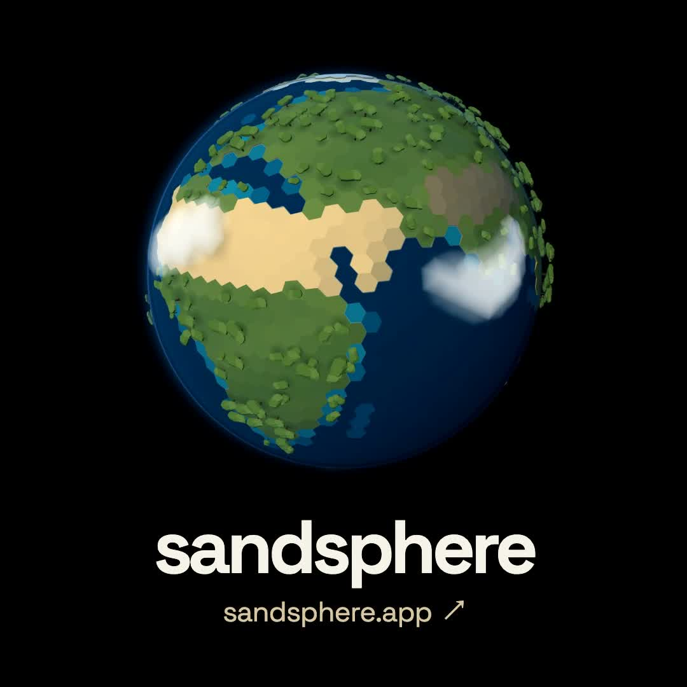

<h1 align="center">Sandsphere</h1>

<p align="center">
  A spherical powder sandbox.<br>
  Combine materials, add heat, and watch a world take shape.
</p>

<p align="center">
  <a href="https://sandsphere.app"><strong>Play Sandsphere ↗</strong></a>
  &nbsp; · &nbsp;
  <a href="#run-locally">Run locally</a>
  &nbsp; · &nbsp;
  <a href="https://github.com/a7garden/sandsphere/issues">Report a bug</a>
</p>

<p align="center">
  <a href="https://github.com/a7garden/sandsphere/actions/workflows/check.yml">
    
  </a>
  &nbsp; <strong>Early alpha</strong> &nbsp; · &nbsp; <a href="LICENSE">MIT license</a>
</p>

<p align="center">
  
</p>

## Make a planet. See what happens.

Start with rock, sand, clay, water, or ice. Add materials, change the heat, and observe how your planet responds.

| Explore | What you can do |
| --- | --- |
| **Land and water** | Pour materials onto a sphere, build terrain, and form seas. |
| **Weather and life** | Watch evaporation, clouds, rain, snow, and vegetation respond to the environment. |
| **Below the surface** | Switch to the section view to inspect material layers. |
| **Planet conditions** | Choose gravity, distance from the star, and initial gases; adjust rotation as you play. |
| **Observation** | Inspect individual locations and track temperature, water, atmosphere, and mass in the dashboard. |

**Sandbox** gives you unlimited materials. **Campaign** adds exploration tasks and inventory. Each mode keeps its own worlds and progress.

English and Korean are available in Settings. Worlds save locally in your browser; account-based cloud saves are available on the live site.

> **Early alpha:** Features and save formats may change. The climate model is experimental and has not passed validation against observed climate.

## Start playing

Open [sandsphere.app](https://sandsphere.app), choose a game mode, and create your first planet.

| Action | Control |
| --- | --- |
| Add material | Select a material, then left-click or drag over the planet. |
| Rotate | Right-drag, or left-drag in grab mode. |
| Zoom | Scroll, or use the on-screen + / − buttons. |
| Stop editing | Press Esc to return to grab mode. |
| Pause or resume | Use the playback button or press Space. |

Touch controls and on-screen navigation are also available. Open the controls guide in Settings for more actions.

## Run locally

Use **Node.js 24**.

```sh
git clone https://github.com/a7garden/sandsphere.git
cd sandsphere
npm ci
npm run dev
```

Open `http://127.0.0.1:5173`. Guest play and local saves work without Firebase configuration.

<details>
<summary><strong>Enable accounts and cloud saves</strong></summary>

Copy `.env.example` to `.env.local` and provide your own Firebase web app configuration. See the [account and operations notes](docs/OPERATIONS.md) for authentication, security rules, and storage setup.

For local Firebase development:

```sh
# Requires Java 21 or newer. Run these in separate terminals.
npm run emulators
npm run dev:emulator
```

The emulator configuration uses `demo-sandsphere`. Keep credentials and service-account keys out of Git.

</details>

## Development

Built with **TypeScript, Vite, and Babylon.js**. WebGPU rendering and compute are used where supported, with a WebGL/CPU fallback. Atmospheric computation runs in a Web Worker, and local saves use IndexedDB.

```sh
npm run check:version
npm test
npm run build
```

To verify Firebase security rules, run `npm run test:rules` with Java 21 or newer installed. GitHub Actions runs these checks for pushes and pull requests.

Bug reports and pull requests are welcome. Include your browser, steps to reproduce, and whether the issue appears in the sphere or section view.

## Model and documentation

Sandsphere uses a discrete spherical grid and simplified material, climate, and ecology models. Its visual scale and simulation time are designed for interaction. Detailed model and validation notes are currently written in Korean.

| Reference | Contents |
| --- | --- |
| [Changelog](CHANGELOG.md) | Version history and verified changes. |
| [Simulation principles](docs/SIMULATION_PRINCIPLES.md) | Shared laws, emergent behavior, current gaps, and implementation acceptance criteria (Korean). |
| [Interaction model](docs/INTERACTION_MODEL.md) | Surface supply, land navigation, and population display limits (English). |
| [Climate and ecology](docs/CLIMATE_ECOLOGY_DESIGN.md) | Scientific basis and model scope. |
| [Layered atmosphere](docs/LAYERED_CLIMATE.md) | Equations, units, and limitations. |
| [Climate benchmarks](docs/CLIMATE_BENCHMARK_RESULTS.md) | Reference comparisons and validation results. |
| [Development notes](docs/DEVELOPMENT_KO.md) | Detailed controls and earlier implementation records. |
| [Operations](docs/OPERATIONS.md) | Account storage, deployment, and rollback. |

## License

Original Sandsphere code is licensed under [MIT](LICENSE).

Bundled scientific data retains its separate [Apache 2.0 license](src/sim/data/LICENSE-APACHE-2.0) and [attribution notice](src/sim/data/NOTICE). Dependencies retain their own licenses.
