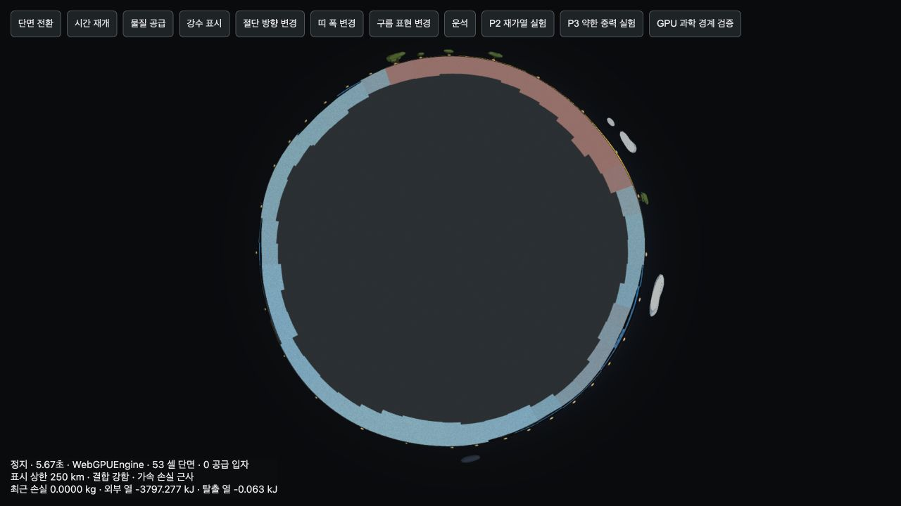

# P1–P3 구현 결과 재감사

> 후속 수정 완료: 아래 R01–R05는 2026-10-10에 모두 수정했다. 최신 결과는 [5건 수정·회귀 검증](REAUDIT_FIXES_VALIDATION.md)을 참조한다. 아래 내용과 기존 증거는 수정 전 재현 기록으로 보존한다.

2026-10-10. 현재 구현을 다시 검토한 결과 **P1 2건, P2 2건, P3 1건의 수정 대상**을 재현했다. 시간·소성 이력·열 장부·단면 카메라의 기본 계약은 유지되고 있지만, 염수의 상 선택과 저장 호환성, 단면 강수 진단에는 결함이 남아 있다. 기존 시험의 통과만으로 전체 완료를 선언할 수 없다.

이번 작업은 감사다. 제품의 물리·렌더·저장 코드는 수정하지 않았고, 추가 재현 도구와 증거를 남겼다. 아래 우선순위는 현재 영향에 따른 재분류이며 과거 C/A 번호의 우선순위와 독립적이다. Git 저장소가 없어 OCR의 변경 파일 선택을 실행할 수 없었다. 현재 소스와 이전 감사·검증 자료를 수동 대조했으며 커밋별 회귀 시점은 확정하지 않는다.

## 확인된 문제

| 번호 | 우선순위 | 문제 | 영향 |
|---|---|---|---|
| R01 | P1 | 완전 동결의 Float32 분배가 음수 질량을 만들고 저장 검증 범위를 벗어남 | 정상 시뮬레이션이 만든 항성계를 저장해도 다음 실행에서 읽지 못할 수 있음 |
| R02 | P1 | 염수의 완전 고체 끝점으로 유효한 혼합 평형을 건너뜀 | 물·얼음·염분 상태가 부적절하며 CPU/GPU 결과가 서로 다른 상으로 갈라짐 |
| R03 | P2 | 단면 강수 데이터가 행성 전환 때 초기화되지 않음 | 새 행성에 이전 행성의 강수 색이 남음. 정지 상태에서는 지속 |
| R04 | P2 | 운송 과제의 목적지 판정이 아직 잘못됨 | 첫 행성에만 공급해도 둘째 행성 운송 과제 완료. 원래 A11의 미해결 항목 |
| R05 | P3 | 단면 강수 색이 비와 눈을 구별하지 않음 | 같은 강도의 비·눈이 단면에서 동일한 파란색으로 표시되어 범례와 불일치 |

### R01 — 동결 반올림과 저장 계약 불일치

위치: [물/얼음 분배](../src/sim/model.ts#L80), [음수 허용 범위](../src/sim/storage.ts#L46), [저장](../src/main.ts#L274), [로드 검증](../src/main.ts#L596).

물 0.8kg, 얼음 4kg, −20°C를 `equilibrateWater()`에 넣으면 얼음은 `4.800000190734863`, 물은 `−1.7881393432617188e−7`kg이 된다. CPU는 합계를 JavaScript 배정밀도로 계산한 다음 얼음 슬롯을 Float32로 반올림하고, 그 반올림된 값을 원래 합계에서 뺀다. 얼음이 합계보다 커지면 남은 물과 용해염이 음수가 될 수 있다. 저장 검증은 `−1e−7`보다 작은 질량을 거절한다.

독립 함수에 한정된 문제가 아니다. 42셀에 같은 물/얼음/온도를 설정하고 ambient −20°C·일사 0·중력 1×로 CPU를 한 단계 진행한 뒤 실제 `snapshotSurface()`로 캡처했다. **첫 단계, 0.0333게임초에서 8셀의 물이 허용 범위 밖 음수**가 되었고 `validSnapshot()`와 `validSystem()` 모두 false였다. 최대 음수는 `−2.384185791015625e−7`kg이다. 일시정지·빈 명령의 캡처는 이를 제거하지 않는다.

`saveSnapshot()`는 저장 형식 검증 없이 기록하고 자동 저장 UI는 성공으로 표시할 수 있다. 로드 시에는 같은 기록을 거절한다. 활성 GPU에서 잘 보이지 않더라도 비활성 행성의 CPU 계산 경로가 남아 있다. 저장 데이터 삭제를 뜻하는 결함은 아니지만 정상 재개를 막는다.

수정 기준: 상 분배의 비음수·물 총량·염분 총량·엔탈피를 함께 보장하고, 저장 직전/로드 직후 계약을 같은 허용 오차로 검증한다. 임의의 큰 음수를 허용하도록 저장 검증만 완화하는 방식은 피한다. 0.8/4kg 같은 비이진 소수, 완전 동결·융해 끝점, 활성/비활성, 정지 직후의 왕복 저장을 회귀 시험에 넣어야 한다.

### R02 — 완전 고체 끝점과 염수 평형의 불연속

위치: [CPU 끝점 판정](../src/sim/model.ts#L71), [WGSL 끝점 판정](../src/sim/physics.wgsl#L66).

현재 알고리즘은 얼음량을 물+얼음 총량으로 놓은 끝점에서 액체와 용해염을 0으로 만들고 `Tf=0°C`를 얻는다. 그때의 온도가 0°C 이하면 혼합 평형 탐색을 생략한다. 그러나 농축 염수의 동결점은 액체가 줄어드는 과정에서 낮아진다. 끝점에서 갑자기 담수 동결점으로 돌아가므로 “bounded and monotonic”이라는 주석의 전제가 성립하지 않는다.

물 0.8kg·얼음 4kg·용해염 0.028kg·−20°C에서 현재 구현은 물을 전부 동결하고 −13.861°C에 도달한다. **같은 비열·잠열·동결점·0.36 용해 한계 공식**에서 0액상 끝점을 제외하고 평형을 구하면 물 0.0542423kg, 얼음 4.7457577kg, 용해염 0.0195272kg, −14.2941°C의 혼합 해가 존재한다. 실측 염수 상태식의 정답이라는 주장은 아니다. 구현이 선언한 게임 공식 내부의 반례다. 에너지 잔차가 작아도 상 선택이 타당하다는 뜻은 아니다.

실제 WebGPU 혼합 저온 시험에서는 162셀·300단계 중 **5단계, 0.167게임초부터 같은 셀의 염분/얼음 분배가 달라졌다**. 첫 추적 셀에서 CPU는 액체 약 0.057864kg·−0.408913°C, GPU는 약 0.000680kg·거의 0°C였다. 최대 온도 차는 94단계에서 2.40637°C이며 그 셀의 액체 차는 0.338705kg이다. 전역 질량과 열 장부가 거의 일치하면서 국소 반응과 이동이 달라졌다. CPU↔GPU 전환이 포함되는 활성/비활성 행성에서도 검증해야 한다.

수정 기준: 액체·얼음·용해염·결정염의 유효 상 영역을 함께 판정하고 끝점의 안정성을 확인한다. 미세 액상에서 사용하는 정규화도 같은 계약에 포함한다. 정교한 해양 상태식 전체를 도입할 필요는 없다. 선택한 단순 모델 안에서 연속적인 상 선택, 비음수, 열·물·염분 보존을 만족하면 된다. CPU와 WGSL의 반올림 차이가 다른 상 분기로 증폭되는지를 이종 셀·장시간 시험으로 검증한다.

### R03 — 행성 전환 후 단면에 남는 강수

위치: [행성 갱신](../src/main.ts#L295), [clearPrecipitation](../src/render/planet.ts#L634), [단면 강수 캐시](../src/render/sectionView.ts#L36).

`refreshWorld()`는 `view.clearPrecipitation()`을 호출하지만 이 메서드는 일반 `PrecipitationLayer`만 비운다. `SectionView.precipitation`과 dt는 유지된다. 새 행성을 `view.update(...,0,...)`로 표시해도 단면은 이전 강수 데이터를 사용한다. 정지된 세계는 다음 양의 dt 강수 갱신이 없어 잘못된 색이 지속된다.

저장과 분리한 실제 WebGPUEngine 장면에 모든 셀 0.001kg/단계의 합성 비를 넣고 `clearPrecipitation()`과 dt=0 표면 갱신을 실행했다. 일반 레이어의 강수 셀은 **642→0**으로 줄고 숨겨졌지만 단면의 최대 강수 강도는 **0.6371163 그대로**였다. 상태 배열은 바꾸지 않았다. 비→눈→초기화 시험에서도 재현됐다.

수정 기준: 행성 교체의 공통 초기화에서 단면 강수 캐시와 dt를 초기화하고 cap 재생성을 요청한다. 같은 행성에서 일시정지할 때 마지막 강수를 유지하는 정책은 보존한다. 행성 전환, 새 행성, 저장 복원, 강수 표시 토글을 별도로 시험한다.

### R04 — 둘째 행성 운송 없이 과제 완료

위치: [과제 설명과 판정](../src/sim/progress.ts#L13).

설명은 “두 번째 행성으로 보관함 물질을 옮기세요”인데 판정은 행성 둘 이상과 **어느 행성이든** `transferredIn>0`을 요구한다. 첫 행성 1kg, 둘째 행성 0kg으로 실제 `advanceProgress()`를 호출하면 `transfer`가 완료된다. 원래 과학·게임 감사 A11에서 이미 지적한 문제로, C06–C11 구현 보고서의 범위 밖에 남아 있다. 새로 발생한 회귀로 분류하지 않는다.

수정 기준: 공급 사건의 목적지와 보관함 출처를 사용하거나 최소한 둘째 행성의 수신량을 판정한다. 첫 행성 공급 후 둘째 행성 생성, 셋째 행성 공급, 저장 복원, 이미 완료한 과제의 유지 정책을 확인한다. 현재 ‘함께 사는 세계’ 설명은 한 행성의 공존을 요구하므로 그 총량 판정을 별개의 섭식 버그로 중복 지적하지 않는다.

### R05 — 단면에서 비/눈 진단값 소실

위치: [강수 채널 합산](../src/render/sectionGeometry.ts#L23), [고정 파란색 셰이더](../src/render/sectionView.ts#L26), [일반 레이어의 색 구분](../src/render/precipitationLayer.ts#L75).

단면은 비·눈을 합친 강도만 vertex data에 넣고 모두 파란색으로 표시한다. 일반 레이어는 눈 비율에 따라 파란색/보라색을 혼합하며 제품 범례도 비와 눈을 구별한다. 같은 강도의 비만 있는 장면과 눈만 있는 장면을 비교하면 일반 레이어 색은 달라지지만 **단면의 sectionData와 color 배열은 완전히 같았다**. 눈 입자 자체가 없는 문제가 아니라 단면 진단 색의 누락이다.

수정 기준: 단면에도 강도와 눈 비율을 별도로 전달하고 같은 범례 색을 적용한다. 비만·눈만·혼합 강수를 비교하고 kg/단계→kg/게임초 변환, 레이어 토글, 셀 상태 불변을 함께 확인한다.

## 기존 감사 항목과의 대조

| 항목 | 재감사 판단 |
|---|---|
| C01 공통 시간·일시정지 | 30Hz, 첫 단계 명령 적용, 배속/배경 분할, 낙하의 물리 시간 계약 유지. 기존 회귀 시험 통과. CPU/GPU의 상 선택 동등성은 R02 때문에 별도 불합격 |
| C02 소성 이력 | 질량 가중 희석·이동·충돌 재분배 유지. 평균 열 이력의 게임 근사로 적절하며 개별 입자의 이력 분포까지 보존하는 모델은 아님 |
| C03 염수 동결 | 공통 엔탈피는 유지하지만 R01/R02가 있으므로 해결 완료 판정을 철회해야 함 |
| C04 물 순환 순서 | 증발·비등 경계와 강수 후 재평형 경로는 유지. 최종 상태의 타당성은 C03의 결함 영향을 받음 |
| C05 에너지 정의 | 환경·명령·탈출·수치 보정 4채널과 물질별 기준 엔탈피 유지. 수지 일치만으로 올바른 상 선택을 보증하지 않음 |
| C06 상층 구름 | 기둥 온도−12°C, 상층 과냉각·동결·융해 정책과 관측 문구 일치. 독립 상층 에너지 저장소를 만들었다고 주장하지 않음 |
| C07 압력·포화·활동도 | 같은 Pa 압력·몰분율 계약, 물/얼음 포화식, 압력별 비등의 인과관계 유지. 농축 염수 EOS·삼중점 이하 완전 상안정성은 모델 범위 밖 |
| C08 생태 환경 | 온도·수분·염분·얼음·구름 차폐, 소비자 적합도와 이동 연결 유지. 생물량/토양 반환의 질량 수지 유지 |
| C09 빠진 상변화 | 유리 재용융·점성 이동·표면 얼음 승화 유지. 금속·용융염·조성별 지질/저온 기체 상 전체는 구현되지 않았으며 경고가 남음 |
| C10 재질·거리·자전 | 조화평균 전도, 거리 보정, 역행 자전 반영 유지. 격자 수렴 시험은 균질 재료의 큰 온도 모드에 한정 |
| C11 외부 열 | 고정 C/목표의 bath 정확 적분과 연속 알베도 유지. 전체 반응계의 정확해 또는 실제 복사 기후 모델로 해석하지 않음 |
| C12 극저중력 대기 | 구면 중력의 경계식, 유한 경계 없음·표시 상한·국소 최소 λ·가속 손실 근사 설명 유지. 실제 단면에서 기체 손실과 탈출 열 반영 확인 |
| 실시간 단면 계약 | 같은 canvas/scene/camera·셀 소유권·고정 내부 편집 방지 유지. 강수 초기화/상 구분은 R03/R05로 미완료 |

과학 단순화의 기준은 실제 물성표의 정밀도를 모든 재료에 강제하는 것이 아니라 **정의한 모델 안에서 상태 조건·보존·표시가 일치하는가**다. 한 기둥 온도, 집계 생태, 확산성 수두 흐름, 재질별 게임 전도율, 평균 소성 이력, 압축된 표시 높이는 현재 파우더토이에서 유지할 수 있다. 이번 결함을 고치기 위해 3D CFD나 깊이별 내부 상태를 도입할 필요는 없다.

물 포화식은 [IAPWS 포화 물성](https://iapws.org/technical-guidance/release/Supp-sat)을 사용하지만 압력과 kg의 대응은 게임 보정이다. 실제 해수 동결은 염분·압력·물/얼음 화학 퍼텐셜의 평형 문제다. [TEOS-10 동결 함수](https://www.teos-10.org/pubs/gsw/html/gsw_t_freezing.html)의 약 35g/kg 예시는 약 −1.9°C이며 현재 낮은 염분 근사의 방향을 지지한다. 농축 염수 전 범위나 R02의 수치적 끝점 판정을 보증하지 않는다.

대기 λ의 3/6 진단은 [Volkov 등의 연구](https://arxiv.org/abs/1009.5110)가 다룬 단일 성분·구면·가열 조건을 모든 행성에 일반화한 인증이 아니다. 0.15/s 가속 손실과 250km 표시 상한은 게임 정책이다. 외부 열 bath도 [NASA가 설명하는 흡수·방출 복사 수지](https://science.nasa.gov/earth/earth-observatory/climate-and-earths-energy-budget/)를 계산하지 않는다. 현재 문구가 이를 분리하므로 그 생략 자체를 새 수치 버그로 분류하지 않는다.

원래 A01–A14 전체 목록의 완료와 셀 감사 C01–C12 완료는 다르다. **A11의 목적지 오류는 남아 있고**, A12의 항성계 체크포인트·복제·낙하 위치/속도/난수 재현은 없다. A13의 단면·핀·열 장부는 구현됐지만 유량 화살표와 반응 사건 관측 전체는 미완료다. A07 복사/온실효과와 C09의 확장 반응망은 명시된 후속 범위다. 자동 저장을 실험 체크포인트 완료로 표시하면 안 된다.

## 실행 검증과 한계

| 시험 | 결과 |
|---|---|
| 최종 `npm test` 단독 실행 | 24개 파일, 148개 통과. 감사 중 다른 UI 작업의 3개 테스트가 추가되어 최초 145개보다 증가 |
| `npm run build` | TypeScript·배포 빌드 통과. 기존 500kB 초과 번들 경고 유지 |
| 기존 실제 WebGPU 경계 시험 | 20개×30단계 통과. 최대 CPU/GPU 온도 차 0.001953125°C, 기존 허용치 0.003°C |
| 신규 단일 셀 반응 검사 | 고정 난수 20261010, 2,200조건, 온도 −100…2500°C와 주요 경계, 중력 0.01/0.03/1/3×. 전부 유한, 질량 잔차 최대 1.33×10⁻⁷, 열 장부 잔차 최대 7.38×10⁻⁷. 27조건은 저장 허용치 밖 음수 질량으로 실패 |
| CPU 이종 162셀 세계 | 3종 중력×300단계. 전부 유한, 잔여+탈출 질량 잔차 최대 3.99×10⁻⁸, 열 장부 잔차 최대 6.18×10⁻⁸. 음수 질량은 여전히 재현 |
| 신규 실제 WebGPU 혼합 시험 | 저온·고온·생태·약중력·정지 명령·완전 동결 6조건. 정지 명령만 dt=0 한 단계, 나머지 300단계. 저온 상 선택의 큰 차이 재현. ‘6개 통과’로 집계하지 않음 |
| 단면 카메라 왕복 | 일시정지 조건에서 셀 변경 0, 시간·질량·엔탈피 변화 0. 같은 canvas/scene/camera 유지. 방향·폭 변경 후 유한 cap·8개 custom shader 공통 clip 유지 |
| 단면 공급/선택 | 12종 공급 입자의 카메라 왕복 전후 질량·위치·속도 불변. 고정 내부 중앙 pick=null, 표면 링은 실제 셀 156 선택 |
| 단면 실시간 약중력 | 1게임초 동안 기체와 총질량 감소, 외부/탈출 열 갱신, 유한 경계 없음·표시 상한·약한 결합 진단 연결. 렌더 오류/경고 로그 없음 |
| 단면 강수 | 상태 불변은 유지하지만 초기화와 비/눈 구분 실패 |

열 잔차의 신규 정규화는 `Σ C|T| + Σ |mℓ|`와 1 중 큰 값이다. 기준 엔탈피의 양·음 상쇄로 상대오차가 과장되는 것을 피한다. 질량은 탈출량을 포함한 장부로 비교했다. 난수 조건은 경계 탐색용이며 실제 플레이 빈도의 통계가 아니다.

혼합 GPU 결과의 최대 차이는 **매 단계 모든 셀**에서 측정했다. 기존 20개 시험의 대부분은 균일한 초기 상태에서 30단계 후를 비교한다. 시험 범위가 달라 기존 숫자와 새 숫자를 같은 통과 기준으로 합쳐서는 안 된다.

| 신규 GPU 조건 | 최대 온도 차 | 셀 질량 차 지표¹ | GPU 열 장부 상대 잔차 |
|---|---:|---:|---:|
| 혼합 저온 | 2.40637°C | 0.338705 | 3.25×10⁻⁶ |
| 혼합 고온 | 0.036865°C | 2.42×10⁻⁵ | 2.20×10⁻⁶ |
| 혼합 생태 | 0.018237°C | 0.002457 | 1.37×10⁻⁵ |
| 약중력 혼합 | 0.016724°C | 4.91×10⁻⁶ | 2.82×10⁻⁶ |
| 정지 명령 | 0.00000191°C | 6.53×10⁻⁸ | 1.19×10⁻¹⁰ |
| 완전 동결 | 0.000636°C | 7.95×10⁻⁷ | 6.24×10⁻⁶ |

¹ `|CPU−GPU| / max(1kg, CPU 셀량)`의 최대다. 행성 전체 질량의 오차율이 아니다. 저온 추적 셀에서 액체 차 0.338705kg을 확인했다. 고온·생태·약중력의 장시간 차이도 허용 오차를 다시 정하고 회귀 시험에 남겨야 한다. 이 수치만으로 각각 새로운 보존 법칙 위반이나 물리식 결함을 단정하지 않는다. 특히 혼합 생태 GPU의 10초 잔차 1.37×10⁻⁵는 기존 1초 시험의 10⁻⁵보다 크다.

CPU 반응 검사·빌드와 동시에 실행한 한 차례 전체 테스트는 P3 42/162/642/2562셀 전도 시험이 기본 5초 제한에 걸렸다. 그 로그를 보존했고, 부하 작업이 끝난 뒤 **기본 timeout 그대로** 단독 재실행해 148개 통과를 확인했다. 재현성 시험의 런타임 여유는 별도 관리할 필요가 있다.

수동 소스 검토는 물리 전이·WGSL·압력/활동도·재질/생태/대기/열식·명령/충돌/낙하·공통 시계·저장/배경 세계·진행 판정, 단면 기하/카메라/클리핑/강수·표면 소유권 및 main/인스펙터의 연결 경로를 포함했다. 다른 동시 작업의 UI 외형·활동 로그 기능 전체와 모든 기기/브라우저/GPU 드라이버는 감사 범위 밖이다. 실제 GPU는 현재 장치, 단면 브라우저 시험은 격리된 fixture이며 이번 턴에 제품 UI의 전체 조작을 새로 반복한 것은 아니다.

## 증거와 재현

- [재감사 CPU 재현 도구](../design/reproduce-reaudit.mjs): `node design/reproduce-reaudit.mjs`.
- [CPU 반응·저장·염수·운송 결과](../design/reaudit-science-evidence.json).
- [혼합 GPU fixture](../tests/reaudit-lab.html)와 [실행 코드](../tests/reaudit-lab.ts): dev 서버에서 `/tests/reaudit-lab.html`의 검증 버튼, 또는 개발자 API `window.reaudit.verify()`.
- [혼합 GPU 결과와 첫 분기/최대 차 추적](../design/reaudit-gpu-evidence.json), [기존 20개 GPU 재검증](../design/reaudit-legacy-gpu-evidence.json).
- [단면 초기화](../design/reaudit-section-reset-evidence.json), [비/눈 비교](../design/reaudit-section-rain-snow-evidence.json), [카메라 왕복](../design/reaudit-section-camera-evidence.json), [12종 입자](../design/reaudit-section-grains-evidence.json), [실시간 약중력](../design/reaudit-section-live-evidence.json).
- [검증 범위·최종 로그·소스/증거 해시](../design/reaudit-verification-summary.json).

강수 재현은 저장과 연결되지 않은 `/tests/section-lab.html`에서 일시정지·단면·강수 표시를 켠 뒤 수행했다. `view.showRain()`에 비 또는 눈 0.001kg/셀·dt=1/30을 전달하고 두 렌더 프레임 뒤 cap vertex data와 일반 레이어 색을 읽는다. 이어 `view.clearPrecipitation(); view.update(state,0,environment)`로 행성 갱신의 초기화 호출을 재현한다. 카메라 시험은 물리를 멈춘 뒤 실제 렌더 루프에서 amount=0/1에 도달할 때까지 기다렸다. 검증용 임시 탭은 종료했으며 사용자 저장은 변경하지 않았다.

후속 수정 순서는 R01/R02의 상 분배·저장 계약, R03/R05의 공통 강수 데이터, R04의 행동 판정이 적절하다. 최종 완료 기준에는 보존 잔차뿐 아니라 **상 평형 잔차, 비음수, 저장 왕복, CPU/GPU 혼합 전이, 행성 전환 후 단면 진단**을 포함해야 한다.
