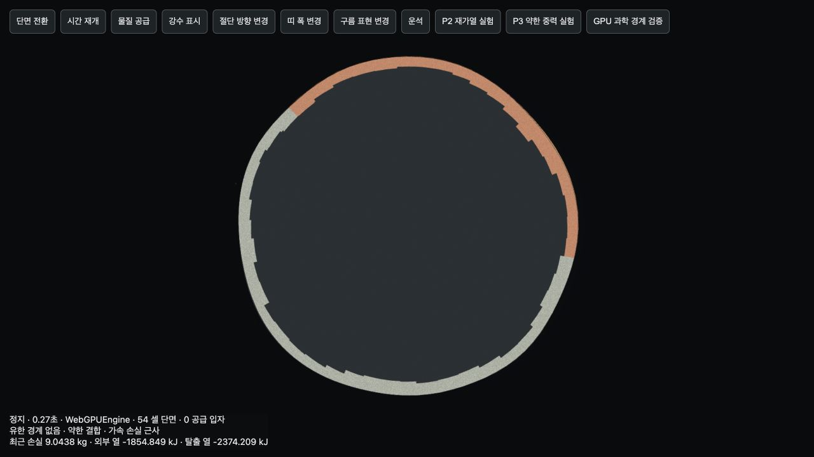
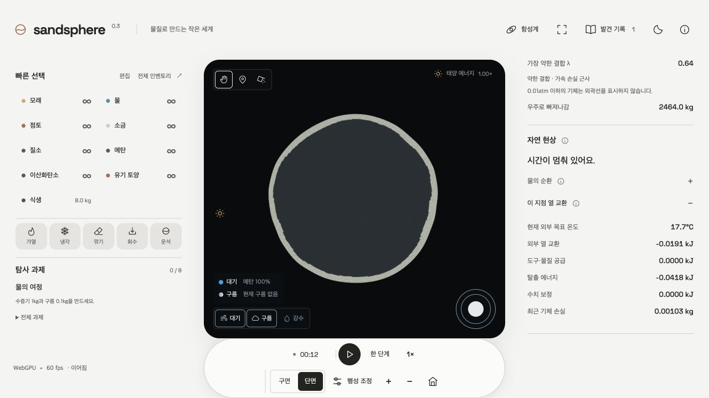

# P3 과학 적용 범위와 단면 검증

2026-10-10. 원래 감사의 A14·C12와 C10·C11의 남은 모델 해석 문제를 수정했다. 과학식의 인과관계는 유지하고, 게임 계수와 적용 범위는 관측창에서 구분한다. 혼합 기둥 24슬롯, 공통 30Hz 물리 단계, 저장 버전 3은 유지한다.

## 항목별 처리

| 항목 | 수정 | 유지한 단순화 |
|---|---|---|
| A14 극저중력 외곽선 | `g(r)=g₀(R/r)²`인 등온 구면식으로 0.01atm 경계를 계산. 유한 경계 없음·유한 경계·표시 문턱 이하를 구별. 계산 높이가 기준 반경의 25%를 넘으면 렌더링을 제한하고 관측창에 설명. | 1000km 기준 반경은 게임 설정이다. 250km 표시 상한은 경험적 UI/모델 범위이며 자연의 보편적인 경계가 아니다. 전 행성의 몰수 가중 평균 온도와 혼합 조성으로 대표 외곽선을 계산한다. |
| C12 기체 탈출 | 셀·기체별 λ를 유지하며 최소 결합도를 표시해 뜨거운 국소 기체가 평균에 숨지 않도록 수정. 작은 손실은 `expm1` 및 GPU 다항식으로 안정 계산. 질량과 평균 엔탈피의 반출 장부 검증. | 0.15/s 가속률을 둔 상대 손실 모델. 외기권 밀도·EUV·유체 탈출·고에너지 분자의 선택적 냉각은 계산하지 않는다. |
| C11 외부 열 | `C dT/dt=K(T목표−T)`를 한 부단계의 고정 C·목표에 대해 정확 적분. 목표를 넘지 않으며 작은 열 교환의 소실을 줄임. 단면에서도 현재 목표 온도와 최근 외부·도구·탈출·수치 보정 열 장부 표시. | 일사·알베도·구름 차폐로 만든 외부 열 bath. 복사 수지·온실효과 모델은 아니다. kg·kJ·반경은 독립적인 게임 보정 척도. 각 기둥은 하나의 온도를 공유한다. |
| C10 공간 보정 | P2의 재질 전도와 거리 제곱 보정에 열 전도의 해상도 수렴 및 장부 검증 추가. | 물질량→높이의 게임 보정과 이웃 그래프를 유지. 모든 셀 면적·부피를 SI로 연결한 3D 유한체적법은 아니다. |

## 대기식의 해석

기준 반경 R=1000km, 표면 척도높이 H₀=RT/(Mg₀)에서

`ln(p₀/p(h)) = (R/H₀) h/(R+h)`

따라서 `L=H₀ ln(p₀/0.01atm)`이면 `h=L/(1−L/R)`이다. `L≥R`에서는 이 등온식으로 유한한 0.01atm 높이를 찾을 수 없다. 기존 평면식의 큰 km 값을 그대로 표시하는 대신 null 경계와 제한된 표시 높이를 사용한다. 이 식의 무한 등온 꼬리도 유한한 총 대기 질량을 보장하지 않는다. 실제 대기의 안정성·수명을 판정하는 식으로 사용하지 않는다.

λ=`g₀RM/(RT)`는 탈출식과 동일한 반경을 공유한다. 단일 성분에서는 λH₀=R이다. λ<3은 약한 결합, 3≤λ<6은 전이, λ≥6은 결합이 강한 영역으로 진단한다. [Volkov 등의 열 탈출 연구](https://arxiv.org/abs/1009.5110)는 특정 단일 성분·구면·가열 조건에서 전이를 분석했다. 이 문턱을 보편적인 실제 행성의 Jeans 적용 판정으로 주장하지 않는다. 모든 영역에서 UI는 가속 손실 **근사**라고 표시하며, `profileValid`도 선언된 게임 범위 안인지 나타낼 뿐 과학적 검증 인증은 아니다.

## 열식의 해석

`Q외부 = C(T목표−T) [1−exp(−K dt/C)]`, K=0.896 게임 열전달 계수. 고정된 C와 목표에서는 시간 분할 결과가 같고, 목표 온도를 넘지 않는다. 물질 이동·상 변화·일사 방향이 달라지는 전체 시뮬레이션은 여전히 유한 시간 단계의 근사다.

온도 목표는 `ambient +72×차폐 후 일사×(1−albedo) −24×sunlight`다. 실제 복사 기후는 흡수 에너지와 방출 열복사의 수지를 풀어야 한다. [NASA 에너지 수지 설명](https://science.nasa.gov/earth/earth-observatory/climate-and-earths-energy-budget/)에 근거해 현재 관측을 외부 bath로 명시했다. 기체의 색·연무 효과를 온실 가열로 해석하지 않는다.

## 검증 결과

- `npm test`: 23개 파일, 145개 테스트 통과. 새 P3 회귀 테스트 11개. `npm run build`: TypeScript·배포 빌드 통과. 기존 번들 크기 경고는 남아 있다.
- 실제 WebGPU: 20개 시나리오 각각 30단계 통과. 새 약중력 메탄, 고온 혼합 기체, 외부 bath 냉각 포함. 최대 CPU/GPU 온도 차 0.001953125°C, 허용치 0.003°C. 셀 질량 상대 차 ≤10⁻⁵, 전역 질량 차 ≤10⁻⁶, GPU 장부 잔차/초기 에너지 ≤10⁻⁵. GPU 일시 정지는 값 변경 0·잔차 0.
- 약중력 0.01×·20°C 혼합 기체 10초: 초기 총질량 474.6000005, 잔여 375.0197926, 탈출 99.58020785 게임 kg. 잔여+탈출 질량 잔차 0, 에너지 장부 잔차 0.00000538 게임 kJ. 선택적 추가 냉각을 가짜로 도입하지 않았다.
- 42·162·642·2562셀, 10초의 구면 y방향 온도 모드: 알려진 bath 감쇠를 제거한 전도 감쇠 0.0052327113 / 0.0054261832 / 0.0054752287 / 0.0054854493. 가장 거친 격자와 세밀한 격자의 상대 차 약 4.61%, 642/2562셀 약 0.186%. 에너지 장부 상대 잔차 최대 5.65×10⁻⁸. 특정 균질 재료의 큰 공간 모드 수렴 검증이며, 모든 재질·급경사의 SI 수렴을 증명하지 않는다.
- 실제 단면 fixture에서 0.01× 중력, 뜨거운 북쪽과 상온 남쪽의 메탄·질소를 재생했다. 유한 경계 없음·250km 표시 제한·실제 기체 감소·외부/탈출 열 장부와 같은 온도장의 단면 색이 연결됐다.
- 동일 scene/camera/canvas의 구면↔단면 왕복: 셀 변경 0, 시간·질량·에너지 변화 0. 절단 방향·폭 변경 후에도 단면 표시와 8개 사용자 셰이더 클리핑 유지.
- 실제 제품 UI의 별도 localhost 테스트 저장소에서 메탄 4×·중력 0.01× 행성을 생성해 WebGPU로 재생했다. 단면 인스펙터의 약한 결합 진단, 기체 손실과 에너지 반출, 0.01atm 이하 외곽선 숨김을 확인했다. 기존 사용자 저장은 사용하지 않았다.

증거: [재현 스크립트](../design/reproduce-p3.mjs), [CPU·빌드 기록](../design/p3-implementation-evidence.json), [GPU 기록](../design/p3-gpu-verification.json), [카메라 왕복 기록](../design/p3-section-verification.json), [제품 관측 기록](../design/p3-product-verification.json).

## 남겨 둔 모델 경계

감사에서 권고한 게임용 근사를 유지하면서 P3의 적용 범위·표시·수치 처리를 해결했다. 깊이별 독립 온도·유체 셀, 실제 복사 온실효과, 외기권/유체 탈출, 금속·용융염·조성별 지질 상태식은 구현했다고 주장하지 않는다. 새로운 반응망이나 고정 기반의 편집은 별도 모델 확장이다. 저장 파일을 변환하거나 질량을 일괄 수정하지 않는다.
