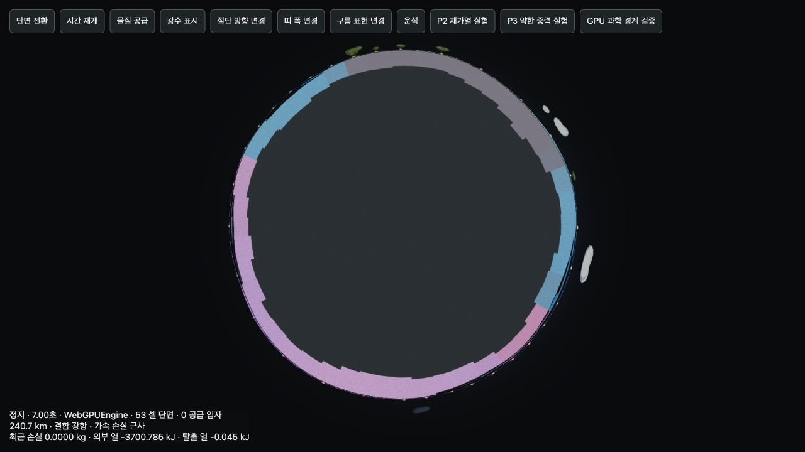

# P1–P3 재감사 5건 수정·회귀 검증

2026-10-10. [재감사](P1_P3_REAUDIT.md)의 R01–R05를 모두 수정했다. 전체 자동 시험 **26파일·166개**, TypeScript 검사와 프로덕션 빌드, 실제 WebGPU 시험 **기존 과학 경계 20개·혼합 세계 6개**가 통과했다. 이번 검증은 아래 상태와 기간을 대상으로 하며 CPU/GPU 비트 단위 동일성을 주장하지 않는다.

## 수정 결과

| 번호 | 수정 | 회귀 증거 |
|---|---|---|
| R01 | 물/얼음과 결정염/용해염은 작은 상을 먼저 저장하고 나머지를 비음수 보수량으로 계산. 저장 전 항성계 검증 및 정규화. 과거 물·용해염의 Float32 보수량 오차만 제한적으로 복구 | 완전 동결·132개 상 경계 조합·120단계 저장 왕복·비활성 행성·실제 IndexedDB/종료 직전 저장 재개 |
| R02 | 액체량을 직접 풀고, 액체가 0에 접근할 때 포화 염수의 어는점 한계를 적용. 전체 염분을 가역적으로 분배하고 엔탈피에서 온도 재계산 | 0.8kg 물·4kg 얼음·0.028kg 염분·−20°C의 잔류 염수, 재가열 시 재용해, 극소량 농도, 실제 GPU 혼합 저온 300단계 |
| R03 | `PlanetView.clearPrecipitation()`에서 표면과 단면의 캐시를 함께 초기화하고 단면 갱신을 예약 | 정지 중 `dt=0`, 숨김 중 초기화, 표시 복귀, 실제 GPU 버퍼 초기화 |
| R04 | 저장된 생성 순서에서 두 번째 행성의 보관함 공급량으로 운송 과제 판정 | 첫째·셋째 행성만 공급하면 미완료, 둘째 공급 시 완료, 완료 기록 저장 후 유지 |
| R05 | 표면과 단면이 동일한 강수 세기·비/눈 혼합 비율·색상 상수를 사용. 단면 셰이더에 눈 비율 전달 | 비·눈·혼합 색상, 임계치·시간 정규화, 실제 GPU의 파랑/보라 단면 |

## 과학 모델과 게임 단순화

기존 게임의 비열·잠열·용해도·어는점 근사를 유지했다. 물과 얼음의 합, 결정염과 용해염의 합, 열 장부를 Float32 정밀도 안에서 보존한다. 염수 어는점은 염분 질량비에 따른 게임 근사이며, 물질량 자체를 0.001kg로 올려 농도를 낮추던 처리를 없앴다. 혼합상에서는 저장된 온도와 농도로 계산한 어는점의 차이도 검사한다.

물·얼음·용해염·결정염에는 **빠른 혼합 평형**을 적용한다. 기존의 별도 느린 용해 처리를 이 평형에 통합했으므로, 따뜻해진 얼음 속 결정염도 액체가 생기면 다시 녹는다. 용해열과 세부 염수 상태방정식은 계산하지 않는다. 같은 비열을 가진 결정염/용해염 사이의 분배에 별도 열원을 만들지 않는다. 관측 패널의 물의 순환 설명에도 이 근사를 표시했다. 이는 실제 염수의 공융점·활동도·용해 속도를 정밀 재현하는 모델이 아니다.

단면은 같은 셀 상태와 강수 진단값을 렌더링한다. 별도 단면 시뮬레이터나 저장 상태를 만들지 않았다. 수정된 잔류 염수가 액체 물로, 얼음이 고체 혼합층으로 표시되는 통합 시험을 추가했다. 회색 내부는 기존의 고정 기반이다.

## 저장·재개

신규 저장은 `prepareSystemSave()`를 거쳐 형식 검증과 비음수 정규화를 한다. 유효한 기존 상태와 실행 중 솔버는 수정하지 않는다. 읽기는 과거 완전 동결에서 발생한 물·용해염의 음수 보수량에 한해 `max(1e−7kg, 관련 물질량 × 2⁻²³)` 범위를 허용하고, 물/얼음·결정염/용해염 사이에서 보정한다. 엔탈피를 기준으로 온도를 다시 계산한다. `−0.01kg`의 물·용해염·구름처럼 범위를 벗어난 상태는 거절한다. 기존의 다른 슬롯에 대한 절대 `1e−7kg` 호환 범위를 확대하지 않았다.

CPU 42셀에서 120단계 매번 저장 검증을 수행했고, 60단계에서 재개한 CPU는 중단 없이 진행한 결과와 비트 단위로 일치했다. 비활성 행성도 6게임초 진행 후 모든 행성의 저장 유효성을 유지했다.

별도 개발 서버의 테스트 저장소에서 실제 앱의 **2,562셀·2개 행성**을 검증했다. CPU 재개 → GPU 재개 → 한 단계 진행 → IndexedDB 저장 → CPU 재개에서 셀 상태, 일시정지, 시간 `123.03333333333332초`, 보관함 유리 2kg을 보존했다. 종료 직전 localStorage 저장도 같은 상태를 보존했다. 감사의 음수 반올림 상태를 포함한 과거 기록은 예상 Float32 상태로 복구되었고, 두 행성 모두 비음수로 재저장됐다. 사용자 저장과 분리된 `127.0.0.1:5197`의 `verification-system` 슬롯만 사용했다.

증거: [저장 재개 결과](../design/reaudit-fixes-resume.json).

## 실제 CPU/GPU 검증

기존 20개 과학 경계는 **30단계의 원래 기준**을 유지했다: 온도 ≤0.003°C, 소성 이력 ≤0.0001초, 셀 물질 차이 ≤1e−5, 전체 질량 상대 차이 ≤1e−6, 열 잔차 상대값 ≤1e−5. 전부 통과했고 최대 온도 차이는 **0.002136°C**였다.

추가 혼합 세계는 162셀에서 300단계·10게임초를 검증했다. 정지 중 명령은 `dt=0` 한 단계다. 매 단계 비음수·유한성·저장 형식을 검사했다. 중간 150단계에서 저장된 CPU를 GPU로, GPU를 CPU로 바꾼 경로도 나머지 150단계의 같은 오차 기준을 통과했다.

| 세계 | 최대 CPU/GPU 온도 차이 | 최대 셀 물질 차이¹ | GPU 열 잔차² | 결과 |
|---|---:|---:|---:|---|
| 혼합 저온 | 0.000676°C | 4.898e−5 | 3.315e−6 | 통과 |
| 혼합 고온 | 0.036865°C | 2.416e−5 | 2.202e−6 | 통과 |
| 혼합 생태계 | 0.002495°C | 1.426e−5 | 1.381e−5 | 통과 |
| 약한 중력 혼합 | 0.016724°C | 4.910e−6 | 2.819e−6 | 통과 |
| 정지 중 명령 | 0.000002°C | 6.526e−8 | 1.191e−10 | 통과 |
| 완전 동결 | 0.000576°C | 7.949e−7 | 5.494e−6 | 통과 |

¹ `|CPU−GPU|/max(1kg, |CPU|)`, 허용치 `1e−4`. 전체 닫힌 질량은 탈출량을 포함하며 상대 차이 허용치 `1e−6`.

² 외부 열·도구 열·탈출 열·수치 보정 장부를 뺀 잔차를 초기 `Σ(C|T|)+Σ|상 에너지|`로 정규화, 허용치 `2e−5`.

300단계의 온도 허용치는 `0.003°C + 5e−5 × max(|CPU 온도|, |GPU 온도|)`다. CPU의 JavaScript 중간 연산과 GPU의 Float32 중간 연산에서 누적되는 오차를 구분하기 위한 기준이며, 기존 1초 경계 시험의 기준을 완화하지 않는다. 고온 결과는 완전 동일하지 않다. 감사에서 상 분기로 **2.40637°C**까지 벌어졌던 혼합 저온의 오차는 **0.000676°C**로 줄었다. 모든 세계에서 질량 최소값은 0이었으며, 저장 중간 상태도 유효했다.

증거: [기존 20개 경계](../design/reaudit-fixes-gpu-boundaries.json), [300단계·백엔드 교대](../design/reaudit-fixes-gpu.json).

## 단면 검증

실제 WebGPU 단면에서 비 648개·눈 630개 정점의 서로 다른 위상 값을 확인했다. 강수 초기화 뒤 강도와 눈 비율은 모두 0이 됐다. 정지 중 `dt=0`에는 마지막 강수를 유지하고, 숨긴 동안 초기화한 뒤 다시 표시해도 이전 강수가 남지 않았다. 구면↔단면 왕복은 같은 캔버스와 셀 상태를 유지했다. GPU 렌더 준비 상태도 정상이다. 실제 앱에서도 정지 중 한 단계 진행으로 첫 행성의 2,562셀에 강수를 생성한 뒤 항성계 UI로 두 번째 행성으로 이동했다. 단면을 다시 열었을 때 현재 강수 0셀, 시뮬레이션 시간 123초, 정지 상태를 유지했고 이전 강수 색은 남지 않았다. 제품과 단면 시험 화면의 콘솔 오류도 없었다.

[단면 회귀 결과](../design/reaudit-fixes-section.json), [실제 행성 전환](../design/reaudit-fixes-product-switch.json), [전환 뒤 제품 단면 화면](../design/reaudit-fixes-product-section-switch.png). 아래 화면은 색 구분을 검증하기 위해 정지한 개발 시험 세계에 비·눈 진단값을 공급한 것이다.

## 재실행

- `npm test`: 26파일·166개 통과. 추가 회귀 12개, 상 경계 내부 조합 132개.
- `npm run build`: TypeScript 검사와 프로덕션 빌드 통과. 기존 큰 번들 경고는 남아 있다.
- `npm run dev -- --port 5197 --strictPort` 후 `/tests/reaudit-fixes-lab.html`: 혼합 세계 버튼 또는 개발 콘솔의 `window.reauditFixes.verify()`.
- `/tests/section-lab.html`: 시간 정지 후 `window.sectionLab.verifyGpu()`로 기존 20개 경계 검증. `reaudit-section-regressions.ts`의 `verifySectionPrecipitation(view, grid, state)`는 같은 시험 세계의 실제 렌더 버퍼를 검사한다.
- `window.reauditFixes.seedResume(false/true)`는 이 개발 서버의 테스트 슬롯에 정상/과거 반올림 기록을 만든다. 실제 앱은 `/?test=1&cpu=1` 또는 `/?test=1`로 재개한다. 사용자 저장용 `latest-system` 슬롯은 쓰지 않는다.

[종합 결과와 소스 해시](../design/reaudit-fixes-verification-summary.json), [자동 시험 로그](../design/reaudit-fixes-tests.log), [빌드 로그](../design/reaudit-fixes-build.log).

이번 범위는 R01–R05다. 이전 감사의 체크포인트 확대(A12), 온실 효과(A07), 더 상세한 유체 모델(A13) 등은 기존 게임 근사의 범위로 남아 있다. 이 시험 결과를 해당 기능의 신규 구현이나 모든 장기·극단 상태에 대한 정밀 과학 검증으로 해석하지 않는다.
